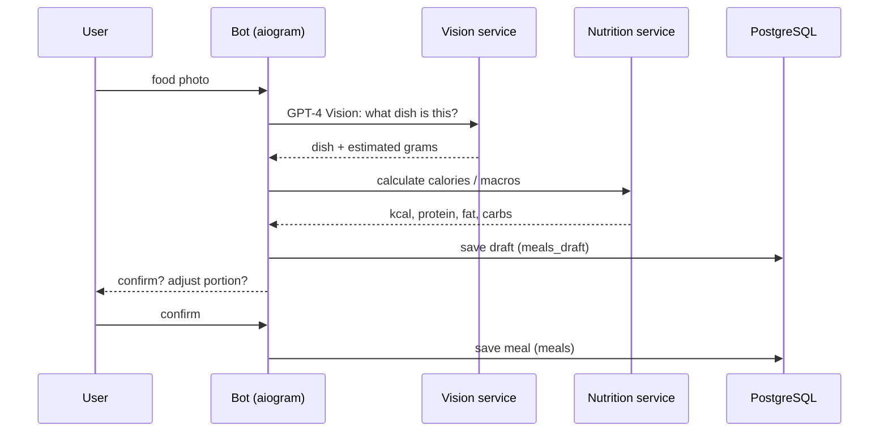
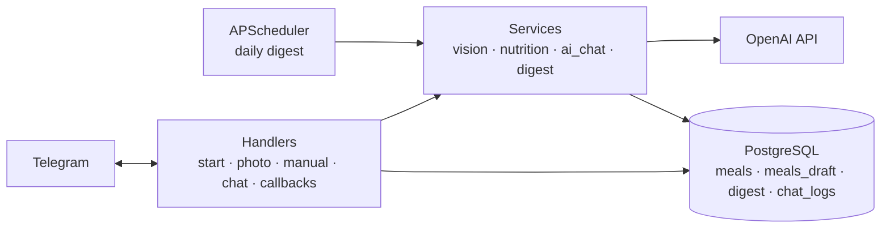

# calApp — AI nutrition tracking bot

A Telegram bot for tracking nutrition. Send a photo of your meal — the bot recognises the dish, estimates the portion and calculates **calories, protein, fat and carbs**. It keeps a food diary, answers nutrition questions based on your eating history and sends a **daily digest** every evening.

## Features

| Feature | Description |
|---|---|
| **Photo recognition** | Dish identification from a photo with GPT-4 Vision |
| **Calories and macros** | Automatic calculation of calories, protein, fat and carbs |
| **Interactive confirmation** | FSM dialog to confirm the dish and adjust the portion before saving |
| **Manual entry** | Quick logging with `/v <dish> <grams> [time]` |
| **AI consultant** | Ask nutrition questions and get advice that takes your history into account |
| **Daily digest** | A nutrition summary sent automatically every evening (21:00 MSK by default) |

## How a meal is logged



## Architecture



```
nutrition_bot/
├── main.py              — entry point
├── config.py            — settings from environment
├── bot/handlers/        — start, photo, manual entry, AI chat, callbacks
├── bot/keyboards/       — inline keyboards
├── services/            — vision, nutrition maths, AI chat, daily digest
├── database/            — SQLAlchemy models, connection, CRUD
├── scheduler/           — scheduled digest jobs
├── utils/               — parsers, time helpers, logging
└── tests/
```

## Configuration

| Variable | Description |
|---|---|
| `TELEGRAM_BOT_TOKEN` | bot token from @BotFather |
| `OPENAI_API_KEY` | OpenAI key |
| `DATABASE_URL`, `DB_USER`, `DB_PASSWORD`, `DB_NAME` | PostgreSQL connection |
| `TIMEZONE`, `DIGEST_TIME` | digest schedule |
| `USER_CHAT_ID` | chat that receives the digest |
| `LOG_LEVEL` | logging level |

## Getting started

```bash
cd nutrition_bot
cp .env.example .env
make docker-up           # bot + PostgreSQL in Docker
make logs
```

Without Docker: `make install`, `make run`, `make test`.

Tech stack: Python 3.11+, aiogram 3, OpenAI API (GPT-4o, GPT-4 Vision), PostgreSQL, SQLAlchemy (async), APScheduler, Docker.

Detailed guides: [`nutrition_bot/README.md`](nutrition_bot/README.md), [`SETUP_GUIDE.md`](nutrition_bot/SETUP_GUIDE.md), [`VPS_DEPLOY.md`](nutrition_bot/VPS_DEPLOY.md).
